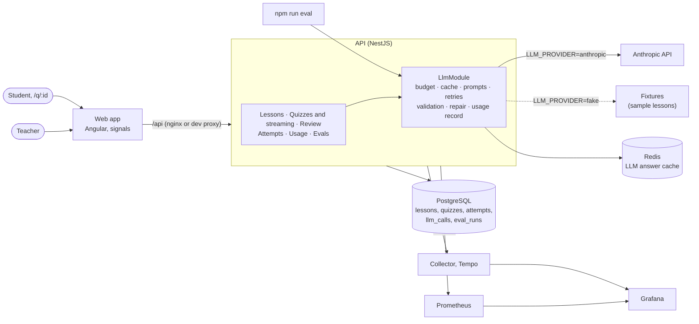

# QuizForge

QuizForge turns a lesson into a reviewed quiz: an LLM drafts the questions, and every one must quote the lesson and pass schema and rule checks before a teacher sees it. The teacher approves, edits, rejects or regenerates each question as it streams in, publishes the quiz, and students take it from a link, scored on the server. An eval harness, with a second model as judge, measures how good the prompt's questions are and compares prompt versions.

> **Demo GIF to be added later.**

## Run it

**Without an API key** (demo mode, needs only Docker):

```bash
docker compose --profile full up -d --build
```

Open http://localhost:8080. The app starts with three sample lessons and one published quiz. In demo mode the fake LLM provider answers the sample lessons with canned quizzes, so open one under Lessons and use **Generate another quiz**; any other lesson is refused with a clear message. Swagger UI is at http://localhost:3001/docs.

**With an API key** (real quizzes from any lesson), pass the provider settings from your shell. They reach the API container as environment variables at run time and are never part of the image:

```bash
LLM_PROVIDER=anthropic LLM_API_KEY=sk-ant-... LLM_MODEL=claude-haiku-5-5 \
  docker compose --profile full up -d
```

Stop it with `docker compose --profile full down`. To run from source (API on :3000, web app on :4200, tests, live tests), see [Development](docs/development.md).

## Architecture



## How an LLM call flows

Every call goes through `LlmService` in `api/src/llm`, so no feature can skip a step ([details](docs/llm-pipeline.md)):

1. **Budget guard:** today's spend from `llm_calls`; at the daily budget it stops with 429 before calling the provider.
2. **Cache:** Redis, keyed by a hash of the prompt, model and variables. Quiz generation and regeneration turn it off (a teacher asking again wants new questions); the eval judge uses it, so an unchanged question is judged once.
3. **Prompt:** a versioned file, with the lesson wrapped in `<lesson>` delimiters as data, not instructions.
4. **Provider call with retries:** up to 3 attempts for 429, 5xx and timeouts, with jittered backoff and `Retry-After`.
5. **Validation:** zod schema, then the quiz rules (the quote is in the lesson, no duplicates, the requested count and types); on failure, **one repair call** that lists the problems.
6. **Usage record:** one `llm_calls` row per call, whatever the outcome (tokens, cost as a decimal, latency, status, prompt and model), plus Prometheus metrics and a trace span.

## Eval results

From the latest eval report, [`2026-10-19T155544Z-v2.md`](api/evals/results/2026-10-19T155544Z-v2.md): quiz prompt v2 with `claude-haiku-5-5` (provider-default effort) on 10 lessons, 57 questions, judged by `claude-sonnet-5-5`.

| Metric | Value | What it measures |
| --- | --- | --- |
| Schema-valid (first answer) | 100% | Lessons whose first answer matched the JSON schema |
| Rule-pass before repair | 100% | Lessons whose first answer passed the schema and every quiz rule |
| Repair rate | 0% | Lessons that needed the repair call |
| sourceQuote found | 100% | First-answer questions whose quote appears in the lesson (after repair it is 100% by the rules) |
| Duplicate stems | 0% | First-answer questions repeating an earlier stem in the same quiz |
| Quote copy | 0% | Final questions whose stem shares 6+ consecutive words with its own quote (lower is better) |
| Shared quote | 3.5% | Final questions whose quote overlaps another question's quote in the same quiz (lower is better) |
| Questions saved | 57 of 57 | 0 dropped: requested minus saved in the final quiz |
| Judge: answer correct | 96.5% | The marked option is right, and the only right one |
| Judge: answerable from lesson | 100% | Answerable from the lesson alone, without outside knowledge |
| Judge: tests understanding | 61.4% | Not answerable by matching words against the lesson |
| Judged questions | 57 | Every final question |
| Generation | $0.0150 | 10 calls, 21,730 in / 25,622 out tokens, 119.5 s in total, slowest 20.9 s |
| Judge | $0.2424 | 57 calls (0 from cache), 75,180 in / 9,199 out tokens |

**Cost and latency per quiz** (same run, 4 to 8 questions each): generation cost $0.0008 to $0.0027, $0.0015 on average; generation time 5.2 to 20.9 s, 11.9 s on average. Judging costs about $0.0043 per question with Sonnet, which is why an eval run costs about $0.25 while generating its 10 quizzes costs under 2 cents.

Compared with prompt v1 over two repeated runs each, v2 cut quote copying from about 25% to about 2% and raised "tests understanding" from about 24% to about 60%, at about 19% more output tokens and slightly more wrong answer keys (2 to 3 in 57 instead of 0 to 1). The app still uses v1. Comparison tables, metric definitions and how to check the judge are in [Evals](docs/evals.md).

## Key design decisions

Each with its reasoning and the alternative considered in [Design decisions](docs/design-decisions.md).

- **One way to call an LLM:** every call goes through `LlmModule`, so budget, cache, retries, validation and cost recording apply everywhere, and tests swap in a fake client.
- **Model output is untrusted** until it passes a zod schema and rule checks, with one repair call, never an open-ended retry.
- **Prompts are versioned files**, and every stored result records prompt, version and model.
- **Money is decimal everywhere it is stored or summed**, never a float.
- **Errors are RFC 9457 problem details** from one global filter, with each field error located by a JSON Pointer.
- **Streaming is JSON Lines over Server-Sent Events**, so each question is validated and saved the moment its line is complete; generation runs in the background and survives disconnects.
- **The eval harness measures the production pipeline**, and its LLM judge is checked against human labels (agreement and Cohen's kappa).
- **Students never receive the answers before submitting**: a separate public response class, and scoring on the server.
- **OpenTelemetry directly, not a hosted agent**, with metrics and spans recorded next to each `llm_calls` row.
- **Demo mode instead of a required API key**: canned answers for the sample lessons, and a clear 422 for any other lesson.

## Known limitations

- **One API instance for live streaming.** Live stream events are kept in the memory of the process that runs the generation. A client connected to another instance still gets the saved questions and the final result, but not the live events in between; Redis pub/sub would fix it.
- **Rate-limit counts are in memory, per instance**, so with several instances a client gets the limit once per instance; the throttler's Redis storage would share it.
- **The daily budget is a soft cap.** It checks the day's spend before each call, so calls running at the same time can together go over it, and a stream that is cut off is counted with estimated usage.
- **`/metrics` is not authenticated.** It holds no lesson content, but in production it should be reachable only from the Prometheus network.
- **No accounts.** The teacher's pages and API are open, and anyone with a student link can submit attempts as often as the rate limit allows, so attempt stats can be skewed; the fix is sign-in or per-student links.
- **Demo mode knows three lessons.** With the fake provider, only the sample lessons work, and regenerating replaces only multiple-choice questions.
- **Eval numbers come from 10 lessons.** One question is about 1.8 points of a judge rate, so repeat a run before trusting a small difference; the judge is one model's opinion until its agreement with a human is measured.
- **Prices are copied by hand** into `api/config/llm-pricing.json` (with the date checked); costs are only as current as that file.
- **Tracing needs the compiled app** (`npm run start:traced`), because the instrumentation must load before the app; it is off in watch mode.

## More

- [Development](docs/development.md): running from source, configuration, the Docker stack, tests and CI
- [API](docs/api.md): every endpoint, generation and review rules, taking a quiz, errors, Swagger and Postman
- [Web app](docs/web.md): the pages and how they are built
- [LLM pipeline](docs/llm-pipeline.md), [Usage, metrics and traces](docs/observability.md), [Evals](docs/evals.md)
- [Design decisions](docs/design-decisions.md) and [Roadmap](docs/roadmap.md), including what I'd do next
